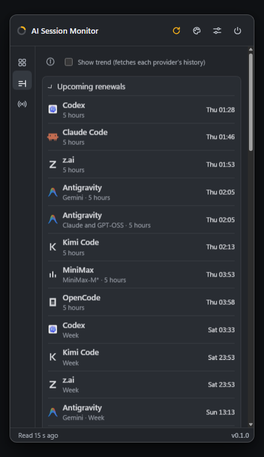
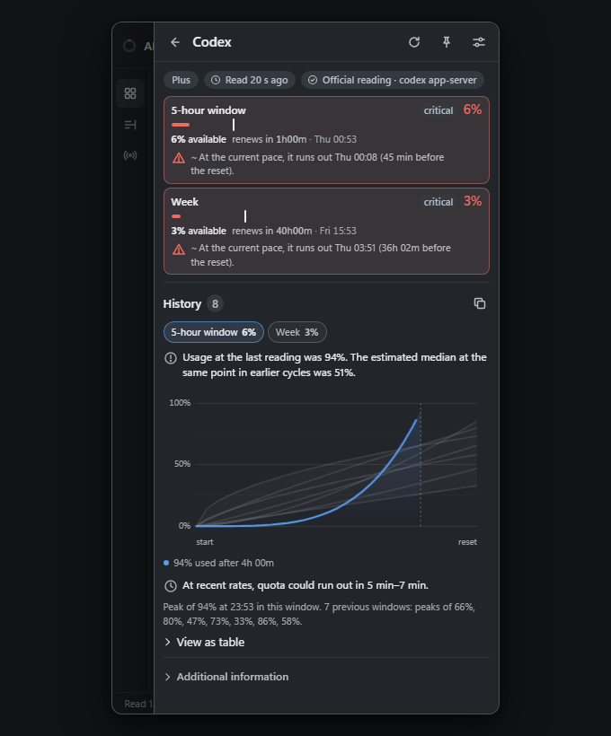

# Evidências de planejamento de cotas

Capturas do build de produção aberto no Chromium em Windows, com o backend simulado do projeto. As horas refletem o relógio local da captura. Os percentuais e as séries são fabricados.

## Calendário de renovações

Em `/?mock=demo`, abra **Horizon → Upcoming renewals**. A captura tem 440 × 760 px. Foram verificadas 23 entradas em ordem cronológica, incluindo duas janelas diferentes do mesmo provedor.

## Previsão no histórico do Codex

Em `/?mock=critical`, abra **Codex → History → 5-hour window**. A captura tem 680 × 820 px. A série simulada acelera nas últimas leituras. Com 94% de uso, os dois ritmos observados indicam esgotamento em cerca de 5 a 7 minutos.

A faixa representa dois cenários de ritmo observado. A cobertura e o erro preditivo em contas reais ainda precisam ser medidos. As capturas validam a interface web, com a bandeja nativa fora desse teste.
